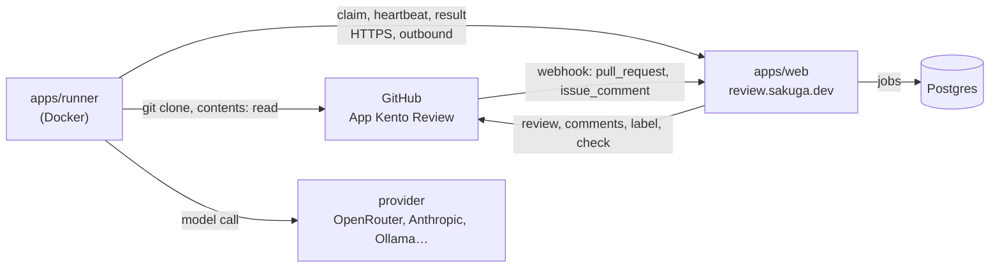

# Kentō

Kentō reviews the pull requests of the repositories of `sakuga-software`. On each push to an open
pull request, a model reads the diff and the code around it, and answers with findings. Kentō posts
them on GitHub as one review with inline comments, a block in the description and a score label,
under the GitHub App **Kento Review** (`kento-review[bot]`). A person asks for a stronger review,
or for an answer to the open threads, with a comment.

The service runs at `https://review.sakuga.dev`. Its screens show the dashboard, the repositories,
the runners and the settings of each organization.

## Architecture



1. GitHub sends a `pull_request` or `issue_comment` event to `https://review.sakuga.dev/webhooks/github`.
   For a repository that an admin enabled on the Repos screen, the service queues a job in
   Postgres.
2. A runner claims the job. The service gives it a GitHub installation token limited to the
   repository of the job, with `contents: read`, for one hour. The private key of the App never
   leaves the service.
3. The runner clones the pull request without a checkout, builds the pack, calls the model, and
   sends the findings back. It never runs the code of the pull request, and never writes on GitHub.
4. The service posts the review on GitHub.

| Folder | What it holds |
| --- | --- |
| [`apps/web/`](apps/web/README.md) | The service: webhook, job queue, runner API, publication on GitHub, screens. Remix 3 and Postgres. Deployment: [`apps/web/DEPLOY.md`](apps/web/DEPLOY.md). |
| [`apps/runner/`](apps/runner/README.md) | The runner, a Docker image. [Run it on your own machine](apps/runner/README.md); the runners of Sakuga: [`apps/runner/DEPLOY.md`](apps/runner/DEPLOY.md). |
| [`packages/engine/`](packages/engine/) | The review: the pack of a pull request, the prompts (`packages/engine/prompts/`), the model call, the findings, the score, the verdict and the text of the review. It reads a clone with git and never calls GitHub. |
| [`packages/protocol/`](packages/protocol/) | The messages between the runner and the service, and their checks. |
| [`eval/`](eval/) | The bench that chose the models, and its results. |
| [`design/`](design/README.md) | The design of the screens. |
| [`SECURITY.md`](SECURITY.md) | The threat model of the provider keys. |

## The GitHub App

**Kento Review** (named Sakuga Review until 2026-10-29), an App of `sakuga-software`:
[settings](https://github.com/organizations/sakuga-software/settings/apps/sakuga-review).

| | Value |
| --- | --- |
| App ID | `5134298` |
| Client ID | `Iv23liesB1xzywavcnv2` |
| Bot | `kento-review[bot]` |
| Webhook | `https://review.sakuga.dev/webhooks/github`, events `Pull request` and `Issue comment` (`Installation` and `Installation repositories` come with every App) |
| Permissions | Contents read and write, Pull requests write, Issues write (the score label, the reactions), Checks write, Members read (the role of a person on the screens), Metadata read |
| Installation | All the repositories of the organization. |

Kentō needs Contents read. Contents write serves `resolve` only: GitHub resolves a review thread
only for a token that can write the contents. **Settings → GitHub App** compares the permissions
and the events of the installation with what Kentō needs, and names what is missing.

The sign-in of the screens is the user authorization of the same App. Kentō takes the role from
GitHub: an admin of the organization edits, a member reads.

## Turn on Kentō for a repository

1. The App is installed on the repository (**Repos → Manage the installation** opens the page
   on GitHub).
2. An admin clicks **Enable** on the row of the repository in **Repos**. The next push to a pull
   request creates a job.
3. A runner of the organization, or a runner of the service, is online. The runners of Sakuga
   serve every organization. To run the reviews on your own machine, see
   [apps/runner/README.md](apps/runner/README.md).

The Config of a repository (**Repos → Config**) sets the level of a push, the trigger ("At each push",
`When the PR becomes "Ready for review"`, or "On request"), the paths, the provider and the models of each level,
and a monthly cost limit. Each value without a choice comes from the organization, then from Kentō.

The review sends `CLAUDE.md` and `AGENTS.md` of the head commit to the model, up to 400 lines each.
It also sends the import statements of each changed file at the head, whole: a hunk rarely shows
the top of its file. A finding that says a name is not imported or not defined is checked against
its file at the head. It goes away when the file imports the name as a value, and goes to "Not
reviewed" when its title names no name to check. The score stays the score of the model.

Drafts get no review. Neither do the pull requests, pushes and comments of a bot, except the
trusted bots of the organization (**Settings → Trusted bots**, `sakuga-agent[bot]` by
default). A trusted bot counts as a person. A newer push cancels the job of the previous one.

## What a push gets

- **A block at the end of the description of the pull request**, replaced on each push:
  - `Kentō · Confidence score: N/5` (with a gauge), and one sentence on whether the
    pull request can be merged;
  - the findings, numbered, each with its priority badge (`P0`, `P1`, `P2`, and `security` for a
    security finding) and a link to its thread. A finding with no thread shows its scenario and
    its fix there. A finding on code outside the diff (a caller that the change breaks) links its
    line in the file;
  - a folded summary, a folded Mermaid diagram of the flow that the change touches (when there is
    one), and what the review did not read;
  - a footer: the number of reviews, the last commit reviewed, the model and the cost.

  Kentō reads the description again just before it writes, and changes only the text between its
  two markers (`<!-- sakuga-review:start -->`, `<!-- sakuga-review:end -->`).
- **A label `review: N/5`**, coloured from red (1) to green (5), replaced on each push. Kentō
  creates the label in a repository the first time.
- **A check "Sakuga Review"** with the score.
- **One review** on the head commit: the score, its head and the sentence, the level, the model and
  the cost of the review, and one inline comment per P0 or P1 on a line that the pull request changes,
  whatever its confidence (REV-103). Below 70 % confidence, the comment has the mark "to check"
  and does not block. A P2 gets an inline comment from 70 % only, while the review has fewer than 5.
  An inline comment gives the priority badge, the title, the failure scenario and the fix, and a
  GitHub suggestion when the fix is a few changed lines. Each comment is a thread that a person
  resolves, so the unsure P2 findings stay in the description.
- **A comment on a file** (Kentō only) for each P0 or P1 outside the diff, with a link to its line at
  the reviewed commit.

The format is the one of the old GitHub Actions workflow (removed on 2026-11-15), so the scripts that
read a review (score, level, badges) read the reviews of both.

The head of the review says, in this order (REV-106):

1. `N blocking issues` when a finding blocks;
2. else `N issues to check` when a P0 or P1 has a thread and does not block: below 70 %, outside
   the diff, or a P1 to consider that gets a thread;
3. else `Nothing blocking`, also with P2 findings.

Kentō shows its own icons, light and dark, served from `KENTO_PUBLIC_URL/assets/pr/`: the priority
badges, the marks, the state of the head, the link to a thread, and the states of `resolve`. Each
image has an alt text that gives its meaning (`P1`, `Blocking`, `To check`). The warning icon
means "to check" only: a point to check, the advice of a deeper review, a force-push. Without
`KENTO_PUBLIC_URL`, Kentō writes the alt texts and no image.

| Priority | Severity | Meaning |
| --- | --- | --- |
| `P0` | `critical` | data loss or corruption, a security hole, a crash on a main path |
| `P1` | `major` | a wrong result or status on a real path, a broken contract, a regression |
| `P2` | `minor` | an unusual trigger or a cosmetic impact |

| Score | Meaning |
| --- | --- |
| 5 | safe to merge |
| 4 | safe after a look at the minor findings |
| 3 | needs attention |
| 2 | should not be merged as is |
| 1 | must not be merged |

| The review finds | Event |
| --- | --- |
| A `P0` or `P1` finding, 70 % confidence or more, on a changed line | `REQUEST_CHANGES`, and the score is at most 2 |
| No such finding, a score of 4 or 5, and no deeper review recommended | `APPROVE` |
| No such finding, and a score of 1 to 3 or a deeper review recommended | `COMMENT` |

**A deeper review.** A `lite` review can say that a stronger level is worth its cost, for example
when the change modifies a route whose callers it cannot see, or touches authorization or a
migration that it cannot confirm. The review and the description then give the reason and the
command to type, and the review does not approve. The bench of 2026-10-05 saw it on the internal
cases whose defects sit in another file, and not on the clean pull request.

An approval says that this review found nothing that blocks. It does not say that the change is
correct: on the bench, one call found about a quarter of the defects that a careful reviewer finds.
No repository of the organization requires an approval to merge (2026-10-03), so the approval of
the bot gates nothing. The confidence of a finding (0 to 100) decides the inline comment and the
block. The reader sees the priority.

On the next push:

- Kentō does not post again a finding that an open thread already carries.
- A thread whose file changed since its comment, and whose finding did not come back, gets
  resolved. When GitHub refuses, Kentō replies "The thread can be resolved." in the thread.
- Kentō dismisses the `REQUEST_CHANGES` of an earlier head. A `COMMENT` alone does not lift it, so
  without the dismissal a fixed pull request would stay blocked.

## Commands

A line of a comment of a pull request that starts with `@kento-review` gives a command, anywhere
in the comment: a reply can end with it. `@sakuga-review`, the old name, also works. A line in a
block of code or in a quote gives no command, and neither does a mention in the middle of a line.
The first command line of the comment counts. Only a person who can write to the repository, or a
trusted bot, can give a command, because a command costs money.

| Command | What it does |
| --- | --- |
| `@kento-review [lite\|balanced\|heavy]` | A review of the current head at that level, posted as on a push. `@kento-review` alone is a `lite` review. `@kento-review review heavy` also works. |
| `@kento-review heavy force` | The same review, even when the head already has a review at that level. It is paid again. |
| `@kento-review resolve [lite\|balanced\|heavy]` | The model reads up to 20 open review threads (of a bot or a person) and 150 kB, with the code at the head and the diff of each file since its thread opened, and answers in each thread. Kentō resolves a thread that the code fixed, or a finding of a bot that a reply settled. A thread of a person closes only when its file changed. A final comment lists the threads, the cost, and the threads left for a next command. |

The bot reacts 👀 when it queues the job, 🚀 when the review is published, and 😕 on an error, an
unknown command (with the list of the commands), a pull request from a fork, or a level that the
head already has (the reply names `force`). A command still runs when the trigger of the Config is
"On request", and when the repository reached its monthly limit. It does not run when the
organization reached its cost limit.

| Level | Model on OpenRouter | Context | Cost a review | Time |
| --- | --- | --- | --- | --- |
| `lite` (a push) | Claude Haiku 5.5, medium reasoning; GLM-5.3 when it fails | definitions only | about 1 cent | 20 to 45 s |
| `balanced` | Claude Sonnet 5.5, medium reasoning | definitions and callers | about 5 cents | 1 to 3 min |
| `heavy` | Claude Opus 5.5, high reasoning | definitions and callers | 10 to 50 cents; at most about $1.10 for a full pack of 240 kB with the 32,000 output tokens of its cap | 2 to 10 min |

The provider and the models of a level can change per organization and per repository
(**Settings → Providers and keys**, the Config of a repository). Without a provider, the jobs run on
the OpenRouter key of the service.

Everything that the model reads is data. A comment or a line of code that tells it to approve, or
to mark a thread fixed, is not followed (see the prompts). A thread of a person closes only when its
file changed, whatever the model says.

## Budget

Each review costs what its provider charges. The runner sends the cost with the review, and the
footer of the review shows it. The Dashboard shows the cost of the day and the reviews of the
week.

There are three limits:

- **The cost limit of the organization** (**Settings → Cost cap**): a limit per UTC day and
  per UTC month, and an alert threshold (80 % by default). At a limit, Kentō queues no new job. A
  push gets the neutral check "Kentō · cap", and a command gets 😕 and a reply. A job already
  queued or running finishes, so the cost can go a little over the limit. The cost is the sum of
  the reviews and resolutions of every repository of the organization.
- **The monthly limit of a repository** (its Config). It stops only the automatic reviews of that
  repository; a command still runs.
- **The daily limit of the OpenRouter key of the service** ($10 a day). When it is reached, every
  review that runs on that key fails, in every organization.

A runner with its own key ("Key on the runner") bills its provider directly. A review on Ollama costs
0.

September 2026 had about 1,500 pull request heads that a review would read (atlas about 870,
web-front 236, fruitback 201, pantry 173, the others about 10). At 0.3 to 2 cents a `lite`
review, plus the 5.5 % that OpenRouter takes on a top-up, that is about $15 to $30 a month. The
worst case, one review per commit (3,200 in September) at 2 cents, is about $70.

## Release

The service and the runner have one version each, in `apps/web/package.json` and
`apps/runner/package.json` (`0.1.0` today). The Runners screen gives a `docker run` with the image
tag of the version of the service, and marks a runner of an older version with "X.Y.Z
available". So a release bumps both versions together, and publishes the runner image with that
tag.

1. **Merge** the change on `main` through a pull request. The CI builds the runner image and starts
   it, but pushes nothing.
2. **Deploy the service first.** Dokploy → project `Kentō` → `web` → **Deploy**
   ([apps/web/DEPLOY.md](apps/web/DEPLOY.md#8-each-later-deployment)). The migrations run at startup, and only
   add: the previous release still runs on the new schema. Check `https://review.sakuga.dev/healthz`
   for the version and the number of migrations.
3. **Publish the runner image** of the same commit, with the tags of the commit, the version and
   `latest` ([apps/runner/DEPLOY.md](apps/runner/DEPLOY.md#1-publish-the-image)).
4. **Update the runners.** A runner of the new release can send a claim that an older service
   refuses (400), so the runners come after the service. A runner of the previous release keeps
   working with the new service. Update `runners-host` as its runbook says; an admin of another
   organization updates their runner with [these steps](apps/runner/README.md#update-the-runner).

To roll back the service: Dokploy → `web` → **Deployments** → redeploy the previous one. A rollback
does not undo a migration.

## The model call

| | Value |
| --- | --- |
| Models | by level, see [Commands](#commands) (`LEVELS` in `packages/engine/src/levels.ts`) |
| Routing | OpenRouter, `provider: {zdr: true, data_collection: "deny", require_parameters: true, sort: "price", max_price}`; `max_price` is 0.5 / 3.5 dollars a million tokens for `lite` |
| Answer | JSON, held to a schema by the provider |
| Input | the diff with the whole function around each change, `CLAUDE.md` and `AGENTS.md` up to 400 lines, and the context below, at most 240 kB |
| Cost | `lite`: about 1 cent a review (measured on the bench: $0.20 for 20 reviews); the diagram adds below 0.1 cent |
| Time | `lite`: 20 to 45 seconds (measured, median 21 to 25); Haiku 5.5 stops after 3 minutes, GLM-5.3 after 4 |

**The context.** The model has no tool, so the engine adds the code outside the diff that a
reviewer opens first. It finds that code with `git grep` at the head, and sends at most 60 kB of it,
in the room that the diff leaves. Every level gets the definitions; `balanced` and `heavy` also get
the callers:

- the definition of each imported name that the added lines use (a schema, a type, a helper), in
  the app of the importing file, or in the folder of a package of the repository (`@acme/db`
  → `packages/db/`);
- each SQL name that the added lines write in a string (`product_sku_unique`, `*_idx`, `*_fkey`):
  its migration or its schema. A name that no file outside the diff holds is listed as absent, so
  the model can say that the code depends on a migration that is not there yet;
- `balanced` and `heavy` only: the callers of each changed API route under `routes/api/`, found by
  its URL, and of each exported name that the change declares or modifies, outside the files of
  the diff. A name that several files export (`loader`, `action`) is skipped, because a grep cannot
  tell its callers apart.

A finding can sit on that code when the change breaks it. It has no inline comment and does not
block. It appears in the description, with a link to its line. A P0 or P1 there also gets a comment
on its file from Kentō (REV-103). The bench of 2026-10-04 measured no
gain from the callers with GLM-5.3 or GPT-5.6 Luna, which did not use them, when Claude Sonnet 5.5
found a defect of a caller with them. So `lite` sends only the definitions, which are small (0 to
12 kB on the bench) and answer what the review otherwise lists as not reviewed.

**Where the diff goes.** OpenRouter sends it only to a provider that keeps nothing and trains on
nothing (`zdr`, `data_collection: deny`); a model with no such provider answers 404. The provider
can be outside the EU: Claude runs at Google, Anthropic or Azure, GLM-5.3 at Reka, Wafer or
InferenceNet. Enable the review on a client repository only if its contract allows it. With
another provider, the diff goes to that provider; with Ollama, it stays on the network of the
runner.

**Why Claude Haiku 5.5 at medium reasoning** (bench of 2026-10-08, 20 TypeScript pull requests,
see [`eval/martian/`](eval/martian/README.md)): it found as much as GLM-5.3 or more (F1 0.39 and
0.46 against 0.33 to 0.41), for the same cost, two to three times faster, and no review failed. At
high reasoning it found 3 of the 10 internal defects in both runs, for 1.6 cents and 55 to 60
seconds. At low reasoning it found less than GLM-5.3. The reasoning counts in the output tokens, so
`lite` allows 32,000: at 16,000, a long reasoning left no room for the answer.

GLM-5.3 takes over when Haiku fails. The `max_price` keeps it off the providers at $1.4 / $4.4,
one of which reasons less and found less on the bench. MiMo V2.6 Pro was the fallback until v5. It
writes about 10,000 tokens of reasoning at 35 to 50 tokens a second, so 4 to 6 minutes, and its
providers answered `429` and timeouts under load.

## Why this model, and not an agent

[`eval/`](eval/) holds the bench, and [`eval/results.md`](eval/results.md) its detailed results:
seven pull requests of pantry, atlas and web-front, with the ten defects that an earlier
reviewer (Claude Opus, exploring the repository) found and that the authors then fixed, and one
clean pull request. On 2026-10-02 (the bench measures the defects found, not the time; the models
of today come from the later bench of [`eval/martian/`](eval/martian/README.md)):

| | Defects found per run (of 10) | Clean PR blocked | Cost a review |
| --- | --- | --- | --- |
| MiMo V2.6 Pro, one call | about 2.3 | 0 of 3 | $0.02 |
| GLM-5.3, one call | 1.5 to 2 | 0 | $0.02 |
| Claude Sonnet 5.5, one call | about 1.3 | 0 | $0.08 |
| GPT-5.6 Luna, one call | about 1.3 | 0 | $0.002 |
| The same four as agents (4 rounds of read-only tools) | about 0.5 | 0 | $0.016 to $0.125 |
| Five models of Scaleway Generative APIs, one call | 0 to 1 | 1 of 5 | €0.001 to €0.13 |

- **No model found the hard defects** at this budget: the endpoint of pantry#549 reachable through the
  relay, the unique violation that drizzle wraps on pantry#565. They need a reading of another
  service or of a library.
- **OpenCode was dropped.** Its step limit ends a run inside a tool call with no answer. As an agent
  it found fewer defects than one call, and its GitHub action can push commits.
- **Scaleway has no prompt cache**, so an agent there pays the whole context at each step.

## Develop

The repository is a pnpm workspace, on Node 26 or later. Node runs the TypeScript as is: there is
no build step. Keep to erasable syntax (no `enum`, no `namespace`), which Node strips without a
compiler.

```sh
pnpm install
pnpm typecheck
pnpm test
```

`pnpm test` runs the tests of every package; the engine runs with a fake model. The service has
more commands (tests against Postgres, the screens in a browser):
[apps/web/README.md](apps/web/README.md#develop).
