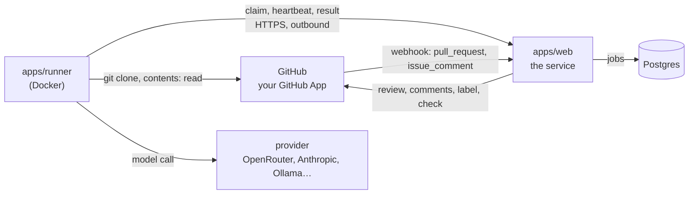

# Kentō

Kentō reviews the pull requests of your GitHub repositories with a language model. On each push to
an open pull request, a model reads the diff and the code around it, and answers with findings.
Kentō posts them on GitHub as one review with inline comments, a block in the description, a score
label and a check. A person asks for a stronger review, or for an answer to the open threads, with
a comment.

You run Kentō yourself: a web service, its Postgres database, and one or more runners that call the
model provider of your choice (OpenRouter, Anthropic, a server with the OpenAI API, or Ollama).

License: to be decided.

## How it works



1. GitHub sends a `pull_request` or `issue_comment` event to the webhook of the service. For a
   repository that an admin enabled on the Repos screen, the service queues a job in Postgres.
2. A runner claims the job. The service gives it a GitHub installation token limited to the
   repository of the job, with `contents: read`, for one hour. The private key of the App never
   leaves the service.
3. The runner clones the pull request without a checkout, builds the pack, calls the model, and
   sends the findings back. It never runs the code of the pull request, and never writes on GitHub.
4. The service posts the review on GitHub.

The service also has screens, with a GitHub sign-in: the dashboard, the pull requests and their
findings, the repositories, the runners, and the settings of each organization. Kentō takes the role
of a person from GitHub: an admin of the organization edits, a member reads.

## What a pull request gets

- **A block at the end of the description**, replaced on each push: the confidence score (1 to 5)
  and one sentence on whether the pull request can be merged, the findings with their priority
  (`P0`, `P1`, `P2`, and `security`), a summary, a Mermaid diagram of the flow that the change
  touches when there is one, and what the review did not read. Kentō changes only the text between
  its two markers (`<!-- sakuga-review:start -->`, `<!-- sakuga-review:end -->`).
- **A label `review: N/5`**, and **a check** with the score.
- **One review** on the head commit, with one inline comment per `P0` or `P1` on a changed line.
  A `P2` of 70 % confidence or more also gets one, while the review has fewer than five. An inline comment gives the failure scenario and the fix,
  and a GitHub suggestion when the fix is a few changed lines. Below 70 % confidence, a comment is
  marked "to check" and does not block.
- **A comment on a file** for a `P0` or `P1` in code outside the diff that the change breaks, such
  as a caller.

| Priority | Meaning |
| --- | --- |
| `P0` | data loss or corruption, a security hole, a crash on a main path |
| `P1` | a wrong result or status on a real path, a broken contract, a regression |
| `P2` | an unusual trigger or a cosmetic impact |

| The review finds | Event |
| --- | --- |
| A `P0` or `P1` finding, 70 % confidence or more, on a changed line | `REQUEST_CHANGES`, and the score is at most 2 |
| No such finding, a score of 4 or 5, and no deeper review recommended | `APPROVE` |
| No such finding, and a score of 1 to 3 or a deeper review recommended | `COMMENT` |

On the next push, Kentō does not post again a finding that an open thread already carries. It
resolves a thread whose file changed and whose finding did not come back, and it dismisses the
`REQUEST_CHANGES` of an earlier head.

Drafts get no review. Neither do the pull requests, pushes and comments of a bot, except the bots
that an admin trusts (**Settings → Trusted bots**). A newer push cancels the job of the previous one.

## Commands

A line of a pull request comment that starts with `@kento-review` gives a command, whatever the
name of your GitHub App. Only a person
who can write to the repository, or a trusted bot, can give a command, because a command costs money.

| Command | What it does |
| --- | --- |
| `@kento-review [lite\|balanced\|heavy]` | A review of the current head at that level. `@kento-review` alone is a `lite` review. |
| `@kento-review heavy force` | The same review, even when the head already has a review at that level. |
| `@kento-review resolve [lite\|balanced\|heavy]` | The model reads the open review threads with the code at the head, and answers in each thread. Kentō resolves a thread that the code fixed. A thread of a person closes only when its file changed. |
| `@kento-review reject [#id] <cause>` | Sets a finding aside with its cause, resolves its thread, and lifts the `REQUEST_CHANGES` when no blocking finding is left. The next review reads the cause. |

The bot reacts 👀 when it queues the job, 🚀 when the review is published, and 😕 on an error or a
refused command, with a reply that gives the reason. Kentō does not review a pull request from a
fork.

## Levels and models

| Level | Default model | Context |
| --- | --- | --- |
| `lite` (each push) | Claude Haiku 5.5, medium reasoning; GLM-5.3 when it fails | the definitions that the change uses |
| `balanced` | Claude Sonnet 5.5, medium reasoning | the definitions and the callers of the changed code |
| `heavy` | Claude Opus 5.5, high reasoning | the definitions and the callers of the changed code |

The defaults are in `packages/engine/src/levels.ts`. An admin changes the provider and the models of
each level for an organization (**Settings → Providers and keys**) and for a repository (its
Config). The footer of each review gives the model and the cost that the provider charged.

The model has no tool. The engine sends the diff with the whole function around each change, the
`CLAUDE.md` and `AGENTS.md` of the head commit (up to 400 lines each), and the code outside the diff
that a reviewer opens first, found with `git grep`: at most 240 kB in all.

Everything that the model reads is data. A comment or a line of code that tells it to approve, or
to mark a thread fixed, is not followed.

## Run it yourself

You need Docker, a machine that GitHub can reach over HTTPS, a GitHub App of your own, and a key of
a model provider (none for Ollama). [`compose.yaml`](compose.yaml) runs the web service, its
database and one runner on one machine:

```sh
cp .env.example .env    # fill it in
docker compose up -d --build
curl -s localhost:3000/healthz
```

1. Create the GitHub App first: [apps/web/DEPLOY.md, section 3](apps/web/DEPLOY.md#3-the-github-app)
   gives its permissions, its events and its URLs. Put its id, its private key, its client id and
   secret, and the webhook secret in `.env`. Set `KENTO_BOT_LOGIN` to the login of the bot of your
   App, `<slug of your App>[bot]`: Kentō finds its own reviews, threads and check by this login. With
   the wrong login, each push posts a new review and a new check, and the `REQUEST_CHANGES` of an
   earlier head is never dismissed.
2. GitHub sends the webhook over HTTPS only. Put a TLS reverse proxy in front of port 3000, and set
   `KENTO_PUBLIC_URL` to its origin.
3. Set `KENTO_ALLOWED_ORGS` to the accounts that you serve. Empty, any account that installs your
   App gets reviews on your runner.
4. The runner of `compose.yaml` registers itself with `KENTO_RUNNER_REGISTRATION_TOKEN`. It calls
   the model with its own key (`PROVIDER_KIND`, `PROVIDER_API_KEY`). The log of the web service then
   gives `runner.registered`, and `/healthz` gives `"status":"ok"`.
5. Install the App on a repository, sign in on `KENTO_PUBLIC_URL` as an admin of its account, and
   click **Enable** on its row in **Repos**. Until then, a pull request of that repository gets no
   job: the log gives `"reason":"repository is not enabled"`.

**Upgrade** the service first, then the runners. The service applies its migrations at startup, and
they only add, so the previous release still runs on the new schema. A runner of a newer release
can send a claim that an older service refuses. A rollback of the service does not undo a migration.
[apps/web/CHANGELOG.md](apps/web/CHANGELOG.md) gives what each release changes.

More:

- [apps/web/DEPLOY.md](apps/web/DEPLOY.md): the deployment of the service, its checks and its
  operations.
- [apps/runner/README.md](apps/runner/README.md): more runners, on other machines, and their
  providers (Ollama included).
- [apps/web/README.md](apps/web/README.md): the webhook, the runner API and the logs.

## Configuration

The web service reads its environment once at startup. [`.env.example`](.env.example) lists the
variables of `compose.yaml`, and [apps/web/DEPLOY.md, section 4](apps/web/DEPLOY.md#4-environment-variables)
explains each one. A missing or invalid value stops the process before it listens, with the name of
the variable and never its value.

| Group | Variables |
| --- | --- |
| Database | `DATABASE_URL` (`POSTGRES_PASSWORD` with `compose.yaml`) |
| GitHub App | `GITHUB_APP_ID`, `GITHUB_APP_PRIVATE_KEY`, `GITHUB_WEBHOOK_SECRET`, `KENTO_BOT_LOGIN` |
| Sign-in of the screens | `KENTO_PUBLIC_URL`, `GITHUB_APP_CLIENT_ID`, `GITHUB_APP_CLIENT_SECRET`, `KENTO_SESSION_SECRET` |
| Provider keys stored on the Settings screen | `KENTO_SECRETS_KEY` (see [SECURITY.md](SECURITY.md#the-master-key)) |
| Who is served | `KENTO_ALLOWED_ORGS` |
| Runners | `KENTO_RUNNER_REGISTRATION_TOKEN`; the variables of the runner are in [apps/runner/README.md](apps/runner/README.md#variables) |

The rest is set on the screens, per organization and per repository:

- **Repos**: the repositories that get reviews. **Repos → Config** sets the level of a push, the
  trigger ("At each push", `When the PR becomes "Ready for review"`, or "On request"), the paths,
  the provider and the models of each level, and a monthly cost limit.
- **Settings**: the providers and their keys, the cost limit of the organization (per UTC day and
  per UTC month, with an alert threshold), the default level and models, and the trusted bots.
  **Settings → GitHub App** compares the permissions and the events of the installation with what
  Kentō needs, and names what is missing.
- **Runners**: the runners of the organization, their trust, and their revocation.

At a cost limit, Kentō queues no new job. A job already queued or running finishes, so the cost
can go a little over the limit.

## Limits

- **An approval gates nothing.** It says that this review found nothing that blocks, not that the
  change is correct. One model call finds part of the defects that a careful reviewer finds. It
  misses most defects that need a reading of another service or of a library.
- **No tools, no execution.** The model reads only the pack that the engine builds. It cannot open
  another file, run the tests or run the code.
- **GitHub only**, with a GitHub App. `GITHUB_API_URL` and `GITHUB_URL` point the service at a
  GitHub Enterprise Server.
- **No review of a pull request from a fork**, and no review of a draft.
- **The diff goes to the model provider.** Choose a provider whose retention and training terms
  suit the code that you review. With OpenRouter, Kentō asks for providers that keep nothing and
  train on nothing. With Ollama, the code stays on the network of the runner.
- **The prompts and the replies of the bot are in English.**
- **The threat model has known gaps**, listed in [docs/threat-model.md](docs/threat-model.md#what-is-not-covered).

## Repository

| Folder | What it holds |
| --- | --- |
| [`apps/web/`](apps/web/README.md) | The service: webhook, job queue, runner API, publication on GitHub, screens. Remix 3 and Postgres. |
| [`apps/runner/`](apps/runner/README.md) | The runner, a Docker image. |
| [`packages/engine/`](packages/engine/) | The review: the pack of a pull request, the prompts (`packages/engine/prompts/`), the model call, the findings, the score, the verdict and the text of the review. It reads a clone with git and never calls GitHub. |
| [`packages/protocol/`](packages/protocol/) | The messages between the runner and the service, and their checks. |
| [`eval/`](eval/) | The bench that chose the models, and its results. |
| [`design/`](design/README.md) | The design of the screens. |
| [`docs/`](docs/threat-model.md) | The threat model of the provider keys. |

## Develop

The repository is a pnpm workspace, on Node 26 or later and pnpm 11. Node runs the TypeScript as
is: there is no build step. Keep to erasable syntax (no `enum`, no `namespace`), which Node strips
without a compiler.

```sh
pnpm install
pnpm typecheck
pnpm test
```

`pnpm test` runs the tests of every package; the engine runs with a fake model. The service has
more commands (tests against Postgres, the screens in a browser):
[apps/web/README.md](apps/web/README.md#develop).

## CI

The workflows are in `.github/workflows`: Test (the packages), Web (`apps/web`), Runner (the image of
`apps/runner`), Secrets (gitleaks) and CodeQL.

- **Where a job runs.** Each `runs-on` reads `github.event.repository.private`. While the repository
  is private, the jobs run on our self-hosted runners, which cost no minutes. Once it is public, they
  run on the runners of GitHub (`ubuntu-latest`), which are free for a public repository: a pull
  request from a fork must not run its code on our machines. A pull request can change the workflow
  it runs, so this choice protects nothing by itself: the runner group of our runners must also
  refuse public repositories.
- **No dependency passes from a pull request to `main`.** On a self-hosted runner,
  `.github/actions/setup-pnpm` removes all the files that an earlier job left, `node_modules` too.
  pnpm itself, its npm cache and the pnpm store of a job are in the temporary directory of the job,
  which the runner deletes after the job.
  The packages come from the cache of `pnpm-lock.yaml`, and GitHub never restores the cache of a
  pull request on `main`. The image builds keep their pnpm store in a BuildKit cache of the Docker
  daemon: the pull requests use one apart (`PNPM_CACHE_ID=pnpm-store-pr`), and only the builds of
  `main` use `pnpm-store`. A pull request can change these files, so this only prevents an accident: on a
  self-hosted runner, the code of a pull request can still write where the runner user can write.
  Only collaborators can open a pull request while the repository is private.
- **Pinned versions.** Each action is pinned by the SHA of its commit, with its tag in a comment, and
  each image of a job by its digest. Dependabot (`.github/dependabot.yml`) proposes the new versions
  of the actions and of the npm packages. It does not update the images of the jobs, nor gitleaks
  in `secrets.yml`: change those by hand.
- **Least privilege.** The token of a workflow has no permission. Each job asks only for what it
  needs (`contents: read`, and `security-events: write` for CodeQL), and no checkout keeps the
  token in `.git/config`.
- **Secrets.** gitleaks scans the history of each commit with its default rules. `.gitleaks.toml`
  lists the fake values of the tests that it must not report.
- **CodeQL.** Code scanning of a private repository needs paid GitHub Code Security, so the CodeQL
  job runs only once the repository is public. `codeql.yml` is the advanced setup of code scanning:
  keep the default setup off, or GitHub refuses its results.

## Contributing, security, conduct

- [CONTRIBUTING.md](CONTRIBUTING.md): how to propose a change.
- [SECURITY.md](SECURITY.md): how to report a vulnerability. Never in a public issue.
- [CODE_OF_CONDUCT.md](CODE_OF_CONDUCT.md): the Contributor Covenant 2.1.
- [apps/web/CHANGELOG.md](apps/web/CHANGELOG.md): what each release changed.
