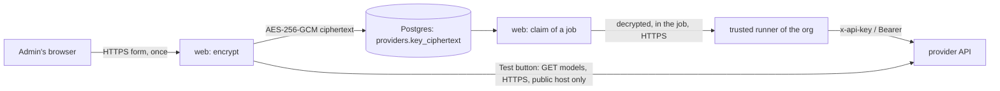

# Threat model: the keys of the model providers

An org of Kentō can add its own providers of models (Anthropic, OpenRouter, a server with the API of
OpenAI, Ollama) on the screen "Settings · Providers and keys". This page is the threat model of
their keys. The generation and the rotation of the master key are in
[SECURITY.md](../SECURITY.md#the-master-key).

## What is protected

- **The key of a provider**: a paid credential of the org (Anthropic, OpenRouter, a private server).
  A thief can spend on it, or read what the org sends through it.
- **The master key** `KENTO_SECRETS_KEY`: 32 random bytes in the environment of the `web` service. With it and a copy of the database, every key can be read.
- **The OpenRouter key of the service** `KENTO_PROVIDER_API_KEY`: the key of the operator of the
  service, for the orgs that have no provider.

## Where a key goes

1. The admin types the key once, in a `password` field, over HTTPS. The form is protected by the
   session (signed `__Host-` cookie, SameSite=Lax), `cop()` and a CSRF token; only an admin of the
   org (role read from GitHub) may post it.
2. The service encrypts it at once with AES-256-GCM (`apps/web/app/providers/secrets.ts`): a fresh
   96-bit IV per encryption, a 128-bit tag, and the additional data `kento:provider:<id>:<org id>`.
   The row keeps `v1:<id of the master key>:<iv>:<ciphertext and tag>` and the last 4 characters.
3. The key goes back out of the service only:
   - in the job of a **claim**, to a runner that is **trusted** at the moment of the claim, of the
     **org of the provider** or of the service, which does not hold that kind of key itself; for that
     one job, over the existing HTTPS runner channel (`providers[].apiKey`);
   - to the **provider itself**, when an admin presses "Test" (`GET /v1/models`, `/models`,
     `/key`), over HTTPS, to a public address only, without following a redirect.

## Threats and what answers them

| Threat | Answer | Where |
| --- | --- | --- |
| A copy of the database (backup, dump, SQL injection that reads) gives the keys | Only ciphertexts and the last 4 characters are stored; the master key is not in the database | `secrets.ts`, migration `0009_providers`, test "keeps no key in clear" |
| A write to the database moves the ciphertext of org A to a provider of org B, so that B's runners receive A's key | The additional data binds a ciphertext to its row and its org: the copy does not decrypt, and the claim gives the job back with "cannot be decrypted" | `providerAad`, DB test "A ciphertext copied to a row of another org does not decrypt there" |
| A runner of another org, or an untrusted one, gets the key | The claim (one SQL statement) gives a job of a provider only to a runner of the same org or of the service, and the key only when the runner is trusted at that moment; the controller checks the trust again before it decrypts | `runner/store.ts` `claimJob`, `runner/controller.ts`, DB tests of the claim |
| The key reaches the browser | The screen reads `ProviderView`, which has no key; a form with an error is rendered again without the key; no notice takes text from the URL | `ui/settings.tsx`, `settings.test.ts` |
| The key reaches the logs | No log line carries a key (the logs name the provider id and kind); the runner redacts every key of a job from its lines; a refusal message from a provider is cut and any token of 16 characters or more is replaced by `…` | `controller.ts`, `apps/runner/src/log.ts`, `refusalMessage` |
| An admin makes the service call its own network with the key (SSRF: the metadata server, the database) through the URL of a provider | "Test" calls HTTPS only, refuses a host that resolves to a private, loopback, link-local, CGNAT or multicast address, and follows no redirect. A URL with credentials, a query or a fragment is refused by the form | `providers/probe.ts`, `providers/form.ts` |
| The provider echoes the key in its error, which ends on the screen | The message is cut to 300 characters and long tokens are replaced by `…` | `refusalMessage`, unit test |
| A stolen master key | Rotate it (below); every key encrypted under the old one is encrypted again, then the old one leaves the environment | `app/providers/rotate-keys.ts` |
| A runner of the org, trusted, is compromised | It receives the key of its org: trust a runner only on a machine you control. The admin can untrust or revoke it on the Runners screen, then replace the key | Runners screen |

## What is not covered

- **DNS rebinding between the check and the call of "Test"**: the service resolves the host,
  checks every address, then `fetch` resolves it again. A host whose answer changes in between could
  still reach a private address once, with the key of its own org. The key belongs to the admin who
  set the URL; the call reads the answer only to tell 200 from 401.
- **The runners call the URL of a provider** (and an Ollama server on a private network) as the
  admin wrote it: the runner is the org's own machine, or a runner of the service that only runs
  public providers in practice. An operator who wants it closed can refuse private addresses on
  the network of the service runners.
- **Memory of the `web` process**: a key is decrypted in memory for the time of a claim or a test.
  A dump of the process memory can show it.
- **A key given with a job lives on the runner** for that job (environment of the process). A job
  already running keeps the key it got after the admin replaces it.
